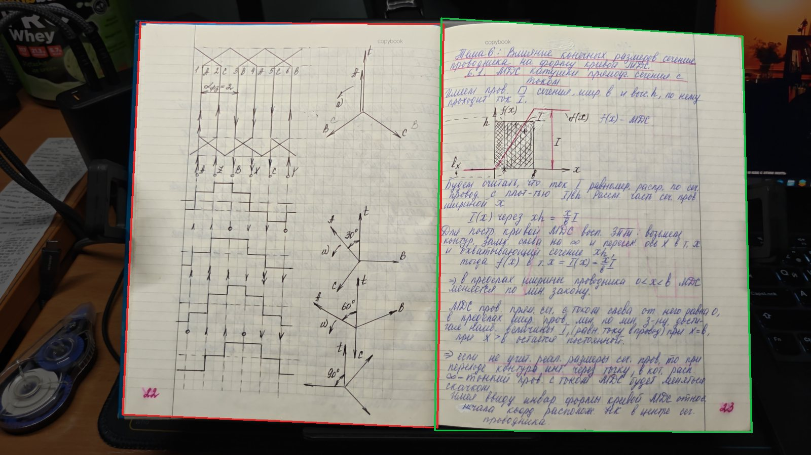
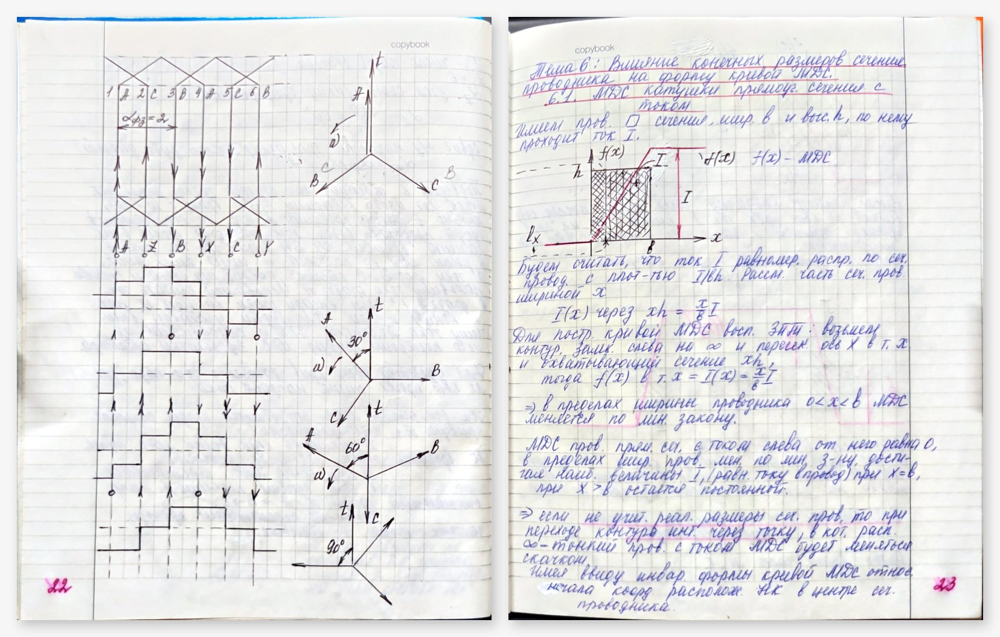

# photo-to-pdf

[](https://github.com/Plasmoid77/photo-to-pdf/actions/workflows/tests.yml)

[](LICENSE)

[Русская версия](README.ru.md)

Turns phone photos of notebooks, books and paper documents into a clean PDF scan.
It splits two-page spreads at the real fold, corrects perspective and crops each
page tightly, without erasing faint pencil near the edges. It is an agent skill
for Claude Code and Codex (`SKILL.md`), and the same script works as a
standalone command-line tool.

The tool finds pages and folds automatically, flags placements that look
implausible, and renders material for checking every page against its photo. It
does not claim a fully automatic result: a person or an agent still looks at
every page before the PDF is final.

## Example

A spread of a lecture notebook on electrical machines, shot with a phone on a
desk. `prepare` found both pages and the fold by itself (red: left page, green:
right page) and raised no flags; the background is dimmed only for this picture.



`build` with these outlines, unchanged, gives two flat pages, one perspective
warp each:



Against the hand-checked outlines of the same photo, the automatic corners are
off by a median of 0.9 % of the page width at the outer edges and 0.5 % at the
fold. The page proportions come from `measure` (5 mm grid). The images are
downscaled for this page.

## What it does

- **Page detection.** Finds paper as a bright, low-saturation region, then snaps
  each edge to the paper-to-dark-background step and fits a robust straight line.
  Skin, a desk or a monitor next to the paper are not taken for paper.
- **Fold detection.** Finds the fold of a spread where the ruling lines break,
  not at the darkest point of the gutter shadow. On a thin notebook that is the
  thin crease line itself. In a deep shadow it is the foot of the brightness step
  on the shadow side.
- **Plausibility flags.** Marks off-centre or ambiguous folds, mismatched page
  pairs, pages touching the frame, aspect outliers, unruled halves (covers) and
  duplicates. A reviewer looks at those pages first.
- **One resampling.** Each page gets one perspective warp, with gentle lighting
  correction and no binarisation. JPEGs are embedded in the PDF without
  re-encoding. Optional crops change only PDF boxes; the image streams are
  verified unchanged.
- **Measurement and review.** Measures the physical page size from the grid
  cells. Renders every page and lists pages with a strip of background or cover
  inside an edge. Shows each page with a margin of the photo around its crop and
  lists pages whose writing runs past the crop at an outer edge. Both lists are
  measured, no model needed.

## Taking the photos

- **Dark background.** Put the paper on a dark, matte surface. Pages are found as
  bright, low-saturation paper against a darker background; a white table, a sheet
  of paper or a lit screen next to the page merges with it.
- **Whole sheet in the frame**, with a small margin. A page that touches the edge of
  the photo is flagged, and whatever is outside the photo is lost.
- **From above, in even light**: no flash glare or hard shadows across the page.
- **One sheet or one spread per photo.** `auto` splits a wide outline only when it
  sees a fold (gutter shading or a crease line), so a landscape A4 sheet stays one
  page; for a batch of loose sheets `prepare --layout pages` is still the safest.
- **Fingers off the writing and the edges**: hold a notebook by the cover.

## Install

```bash
git clone https://github.com/Plasmoid77/photo-to-pdf ~/.claude/skills/photo-to-pdf   # Claude Code
# or ~/.codex/skills/photo-to-pdf for Codex
python3 -m pip install -r ~/.claude/skills/photo-to-pdf/requirements.txt             # or use system packages
```

Requirements: Python ≥ 3.10, Pillow, NumPy, OpenCV, ReportLab, pypdfium2 (for
`crop` and the tests), and Poppler `pdftoppm` (for `review` and for `measure` on
a PDF). If OpenCV comes from system packages, create the virtual environment on
the same interpreter with `python3 -m venv --system-site-packages`.

## Workflow

```bash
S=~/.claude/skills/photo-to-pdf/scripts/scan.py
python3 $S prepare photos/ --work work --layout auto          # draft manifest + contact sheets
python3 $S inspect work/manifest.json --work work/inspect --ids 0006-L,0006-R   # corner close-ups for manual fixes
# check every outline, fix quads, exclusions and order, then set "reviewed": true
python3 $S build work/manifest.json --output work/draft.pdf   # one warp per page
python3 $S measure work/draft-pages --work work/measure       # page size from 5 mm cells -> aspect, --width-mm
python3 $S build work/manifest.json --output work/final.pdf --width-mm 165
python3 $S review work/final.pdf --work work/review          # renders, contact sheets, edge report
python3 $S compare work/final.scan.json --work work/compare   # what lies outside each crop
```

`crop` trims finished PDF pages without re-encoding them; `eval` compares a
fresh `prepare` with a verified manifest of the same photos (see below). Every
command, the manifest format and the flags are described in
[references/commands.md](references/commands.md) (in Russian). `scan.py <command> -h`
lists the options.

## Accuracy

Checked on two real notebooks (photos not included, except the example spread):

| | photos | pages | fold error, median | fold error, worst unflagged | silent failures (> 3 % of page width) |
|---|---|---|---|---|---|
| thick notebook, deep gutter shadow, desk and monitor around | 78 | 155 | 3.2 px | 13.5 px | 0 |
| thin school notebook held in the hand | 48 | 95 | 2.4 px | 9.7 px | 0 |

The fold reference is the ruling break, marked by eye at three heights on each of
122 spreads. The earlier shadow-edge method put the fold a median 7 px into the
right-hand page of the thick notebook. 10–15 % of pages were flagged; these
were mostly legitimate (cover spreads, pages cut by the frame, a monitor merged
with the paper).

Draft outlines from `prepare` against the verified manifests of the same photos
(worst corner of a page, % of the page width):

| | original version (8fa42d6) | current version |
|---|---|---|
| thick notebook, 78 photos: median / pages over 3 % / silent failures | 3.8 % / 99 of 154 / no flags at all, every outline is a draft | 0.7 % / 5 of 153 / 0 (13 pages flagged) |
| thin notebook, 48 photos: pages found / median / pages over 3 % / silent | 35 of 95 / 20.5 % / 33 / no flags | 95 of 95 / 0.5 % / 5 / 0 (14 flagged) |

`compare` (below) found writing cut off on 4 pages of the thin notebook's
hand-checked reference; their edges were moved out to the writing, and the
current column is measured against that reference. Before, one page counted as a
silent failure: the top of a fold 3.6 % too high; against the corrected
reference it is 2.8 %. On a spread the paper bends down
towards the fold, so a straight top edge leaves a wedge of background in the
corner at the fold. `prepare` now pivots the top edge down to the paper there
(`gutter_dip` in the manifest), unless pen strokes on the paper lie in the way.
The hand-checked reference of the thick notebook had kept that wedge; its
gutter-top corners were moved down to the paper on 58 pages, each checked by
eye, and both columns are measured against the corrected reference. A
coloured cover with a bright rim above the pages used to pull the top edge onto
the rim, leaving a strip of cover inside 35 left pages of the thick notebook
(0.6–2 % of the width); the edge now steps over a saturated band to the paper,
which brought the median outer-corner error there from 0.9 % to 0.3 %.

## Test on a real task

Two agents on the same model (Claude Opus 5.5) were given the same request:
turn the 48 photos of the thin notebook into a checked PDF following the
skill. One used the original version, the other the current one. Neither had
access to the reference or the fold labels, and neither could start sub-agents.
Both produced 91 pages and excluded the same kinds of pages: the blank inside of
the cover, a re-shot spread and an empty last page.

| | original version | current version |
|---|---|---|
| active time | 66 min | 44 min |
| tool calls (image views) | 306 (193) | 215 (137) |
| cached input read / output tokens | 54 M / 188 k | 27 M / 123 k |
| fold error vs hand labels, median / max | 2 px / 18 px | 2 px / 18 px |
| blind check of every page: lost writing / noticeable / minor defects | 0 / 7 / 25 | 0 / 9 / 20 |

With the original version the agent got the same final quality by writing its
own fold and edge detection, then correcting 33 of 91 pages by hand; with the
current version it corrected 9 pages of the `prepare` draft. Reviewer judgements at the crop line are uncertain
by a few defects, so the two final PDFs are equal in quality; the difference is
the effort. In this test `prepare` took 143 s for 48 photos (33 s for the original
version); it now processes photos in parallel and takes 22 s on 8 cores (36 s for
the 78 photos of the thick notebook), with identical output.

A third run of the same task used the cheap-model screening (now in `references/screening.md`):
six Sonnet agents looked at all 91 `compare` images, and the main agent (Opus)
opened only the 13 flagged pages and the 11 pages the screeners marked (3 real
defects, fixed). The three final PDFs were then compared side by side in one blind check.

| | current version, no screening | with screening |
|---|---|---|
| time | 44 min | 12 min |
| main-agent tool calls (image views) | 215 (137) | 84 (38) |
| main agent: cached input / output tokens | 27 M / 123 k | 7.4 M / 45 k |
| screeners (Sonnet): input / output tokens | — | 0.7 M / 19 k |
| fold error vs hand labels, median / max | 2 px / 17.5 px | 2 px / 16.8 px |
| blind check of every page: lost / noticeable / minor | 0 / 0 / 37 | 0 / 0 / 33 |

The original version scored 0 / 0 / 19 in that blind check: its agent placed the
corners by hand. Most minor defects of the current version are a small wedge of
desk at the top corner next to the fold. One run per version.

The same screening scheme was then run once on the thick notebook (78 photos),
which the screening brief was not tuned on, with the version that also follows
the paper down at the fold. The agent produced 153 pages in 10.6 min with 66
tool calls (32 image views); the main agent read 5.0 M cached input tokens and
wrote 33 k, the ten Sonnet screeners took 1.2 M input and 30 k output tokens. It
fixed the cover (one page, not a spread), corners on five photos and a skewed
fold. Against the hand-checked reference the corners are off by a median of
0.9 % (outer) and 0.6 % (fold); one included page differs by more than 3 %,
a blank strip of paper cut off at the bottom, no writing lost. No blind check
was run for this notebook.

The same request in Codex (main agent `gpt-6.1-sol`, medium; `gpt-5.6-luna`
screeners) produced 153 pages in 9 min: 47 commands, 4.0 M input tokens (3.85 M
cached) and 10.5 k output for the main agent, about 0.26 M for the screeners.
The agent fixed the same places (cover, endpaper, corners, the fold on photo
77); median corner error 0.9 % (outer) and 0.6 % (fold), no included page over
3 %. The luna screeners marked no page, although the draft had a 7 % corner
error (0077-L, caught by a `prepare` flag). On the same 153 images
`gpt-6.1-terra` (0.4 M tokens) found 0077-L and 3–5 of the 16 pages at 2–3 %, but
marked 37–43 pages: thin slivers of cover or background at the top edge (1–2 %
of the width, which the reference keeps as well) and lines running into the
fold. A stricter brief did not reduce the count. In Codex neither model replaces
a Sonnet screener: rely on the `prepare` flags and look at the pages yourself.

`review` now measures such strips itself: along each side, how deep non-paper
(much darker than the paper, or a saturated cover) runs in from the edge. With
the defaults (deeper than 0.6 % of the page width along more than 20 % of a
side) it listed 34 pages of that Codex draft, including all 31 left pages with
a strip of cover at the top, none of the 153 pages of the hand-checked PDF of
the same notebook, and 7 of the 91 pages of the thin notebook's final PDF, all
torn or curved paper edges with 0.6–1.6 % of background. It costs no tokens.
It does not see cut writing or a fold placed inside a page (such as 0077-L).

`compare` now lists cut writing at the outer edges: pen strokes on the sheet's
own paper outside the crop (ruling, the crease, the desk, a logo on it and a
cover edge do not count). It listed no page of the hand-checked thick notebook
or of the Codex draft, and 4 of the 91 pages of the thin notebook's
hand-checked PDF; all 4 were real, checked by eye: tops of letters in the first
line on two pages and dates written along the outer edge on two. With the outer
edges of the thick notebook moved 1.5 % inward it listed 33 pages, mostly the
last line at the bottom. The fold side is not checked: there the facing page's
writing lies outside the crop, and a misplaced fold is left to the `prepare`
flags. With these two lists, the `prepare` flags cover what the cheap screeners
were for; the screeners remain optional.

The same Codex request was then run once with this version and no screeners
at all. It took 16.7 min, 39 commands, 10.0 M input tokens (9.7 M cached) and
24 k output (plus 8 k reasoning). The agent fixed the cover and endpaper as
before, then trimmed about 120 corners by eye 0.3–2.5 % inward to drop thin
wedges of desk on blank margins, mostly at the top next to the fold. Its final
PDF has no strip and no cut writing in the `review` and `compare` lists. Against
the reference, which follows the paper edge, the corners are off by a median of
0.3 % (outer) and 1.2 % (fold); the two pages over 3 % are such trims of blank
paper at the fold, checked by eye. One run; the extra time and tokens against
the screened run went into that manual trimming.

Known limits: a page edge is fitted with a straight line, so a strongly curled
page keeps a sliver of background at the corners or loses a few pixels of paper.
Pen strokes between the tight edge and the paper edge move the edge outward
(`margin_ink`, up to 4 % of the page width); pencil is not protected this way.
Writing that runs to the physical edge of the paper stays at the edge. On the
thick notebook the outline can take the white edges of the sheets underneath
into the top-left corner (about 1 % of the page): the paper mask itself ends at
the cover there. Writing that is outside the photo cannot be recovered.

## Tests

```bash
python3 -m unittest discover -s tests -v
```

The tests generate synthetic spreads with and without a gutter shadow, plus a
cardboard cover, a blue cover rim above the pages, and a curved outer edge with and without a date written in it.
They check detection accuracy and flags, keeping margin writing, `eval` (including a
detected failure), `build` page size, refusal to build unreviewed pages, `crop`
with unchanged image streams, `measure` of a known grid, `compare` (including cut writing), `inspect` and
`review` (including a strip of background at an edge).

## License

GPL-3.0-or-later, see [LICENSE](LICENSE).
