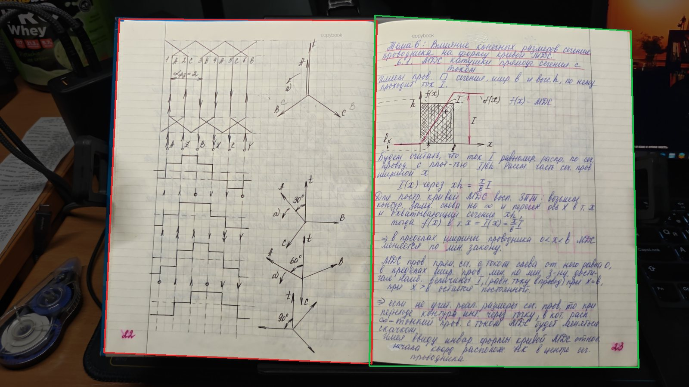
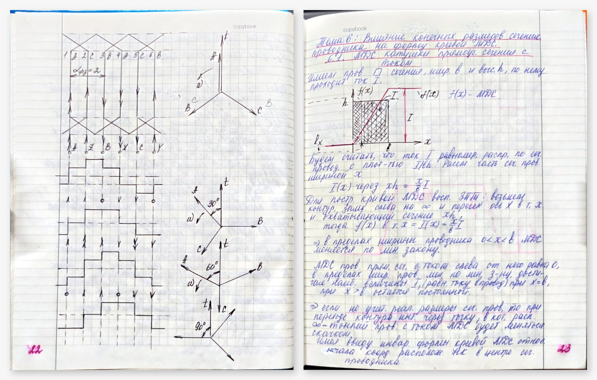

# photo-to-pdf

[](https://github.com/Plasmoid77/photo-to-pdf/actions/workflows/tests.yml)

[](LICENSE)

[English version](README.md)

Превращает фотографии тетрадей, книг и бумажных документов, снятые телефоном, в
аккуратный PDF-скан. Разворот делится по настоящему сгибу, перспектива
исправляется, каждая страница обрезается плотно, но бледный карандаш у краёв не
теряется. Это навык (skill) для Claude Code и Codex (`SKILL.md`), а тот же скрипт
работает и как самостоятельная утилита командной строки.

Страницы и сгибы находятся автоматически, неправдоподобная разметка помечается
флагами, для проверки готовятся материалы, где каждую страницу можно сравнить с
её фото. Полностью автоматического результата инструмент не обещает: человек или
агент смотрит каждую страницу, прежде чем PDF считается готовым.

## Пример

Разворот конспекта по электрическим машинам, снятый телефоном на столе.
`prepare` сам нашёл обе страницы и сгиб (красный — левая страница, зелёный —
правая) и не поставил ни одного флага; фон затемнён только для этой картинки.



`build` с этими контурами без правки даёт две ровные страницы, по одному
перспективному выпрямлению на каждую:



Против проверенной вручную разметки того же фото автоматические углы
отличаются в медиане на 0,9 % ширины страницы у внешних краёв и на 0,5 % у
сгиба. Пропорции страницы взяты из `measure` (клетка 5 мм). Картинки здесь
уменьшены.

## Что умеет

- **Поиск страниц.** Бумага находится как светлая малонасыщенная область. Каждая
  кромка притягивается к переходу «бумага → тёмный фон», затем через неё
  проводится робастная прямая. Кожа, стол и монитор рядом с листом не
  принимаются за бумагу.
- **Поиск сгиба.** Сгиб разворота — место, где ломаются линии разлиновки, а не
  самая тёмная точка тени корешка. В тонкой тетради это тонкая линия сгиба. В
  глубокой тени — основание перепада яркости со стороны тени.
- **Флаги правдоподобия.** Помечаются сгиб не по центру или неоднозначный,
  несовместимые страницы разворота, страницы у края кадра, выбросы по
  пропорциям, половина без разлиновки (обложка) и дубли. Такие страницы
  проверяются первыми.
- **Один ресэмплинг.** Одна перспективная матрица на страницу, мягкая коррекция
  освещения без бинаризации. JPEG встраивается в PDF без перекодирования.
  Дополнительная обрезка меняет только рамки PDF, а неизменность изображений
  проверяется.
- **Измерение и проверка.** Физический размер листа считается по клетке. Все
  страницы рендерятся, страницы с фоном или записью у края перечисляются. Каждую
  страницу можно увидеть вместе с полосой фото вокруг её обрезки.

## Установка

```bash
git clone https://github.com/Plasmoid77/photo-to-pdf ~/.claude/skills/photo-to-pdf   # Claude Code
# или ~/.codex/skills/photo-to-pdf для Codex
python3 -m pip install -r ~/.claude/skills/photo-to-pdf/requirements.txt             # или системные пакеты
```

Нужны Python ≥ 3.10, Pillow, NumPy, OpenCV, ReportLab, pypdfium2 (для `crop` и
тестов) и Poppler `pdftoppm` (для `review` и для `measure` по PDF). Если OpenCV
стоит системным пакетом, создавайте виртуальное окружение на том же
интерпретаторе: `python3 -m venv --system-site-packages`.

## Порядок работы

```bash
S=~/.claude/skills/photo-to-pdf/scripts/scan.py
python3 $S prepare photos/ --work work --layout auto          # черновой manifest и контактные листы
python3 $S inspect work/manifest.json --work work/inspect --ids 0006-L,0006-R   # углы крупно для ручной правки
# проверить каждый контур, поправить углы, исключения и порядок, поставить "reviewed": true
python3 $S build work/manifest.json --output work/draft.pdf   # одно выпрямление на страницу
python3 $S measure work/draft-pages --work work/measure       # размер листа по клетке 5 мм -> aspect, --width-mm
python3 $S build work/manifest.json --output work/final.pdf --width-mm 165
python3 $S review work/final.pdf --work work/review          # рендеры, обзоры, отчёт по краям
python3 $S compare work/final.scan.json --work work/compare   # что осталось за обрезкой
```

`crop` обрезает страницы готового PDF без перекодирования. `eval` сравнивает
свежий `prepare` с проверенным manifest тех же фото (см. ниже). Все команды,
формат manifest и флаги описаны в [references/commands.md](references/commands.md);
список параметров — `scan.py <команда> -h`.

## Точность

Проверено на двух настоящих тетрадях (фото в репозиторий не входят, кроме разворота из примера):

| | фото | страниц | ошибка сгиба, медиана | худшая непомеченная ошибка сгиба | тихих ошибок (> 3 % ширины страницы) |
|---|---|---|---|---|---|
| толстая тетрадь, глубокая тень корешка, стол и монитор вокруг | 78 | 155 | 3,2 px | 13,5 px | 0 |
| тонкая школьная тетрадь в руке | 48 | 95 | 2,4 px | 9,7 px | 0 |

Эталон сгиба — излом разлиновки, отмеченный вручную на трёх высотах на каждом из
122 разворотов. Прежний способ (по краю тени) ставил сгиб толстой тетради в
среднем на 7 px внутрь правой страницы. Помечено 10–15 % страниц, в основном по
делу: развороты с обложкой, страницы, обрезанные кадром, монитор, слившийся с
листом.

Черновые контуры `prepare` против проверенной разметки тех же фото (худший угол
страницы, % ширины страницы):

| | исходная версия (8fa42d6) | текущая версия |
|---|---|---|
| толстая тетрадь, 78 фото: медиана / страниц хуже 3 % / тихих ошибок | 4,1 % / 107 из 154 / флагов нет, каждый контур черновой | 1,1 % / 5 из 153 / 0 (помечено 16) |
| тонкая тетрадь, 48 фото: найдено страниц / медиана / хуже 3 % / тихих | 35 из 95 / 20,5 % / 33 / флагов нет | 95 из 95 / 0,4 % / 8 / 1 (помечено 14) |

Оставшаяся тихая ошибка — верх сгиба на 3,6 % выше нужного: полоска фона, запись
не потеряна.

## Проверка на реальной задаче

Два агента на одной модели (Claude Opus 5.5) получили одинаковую задачу: собрать
из 48 фото тонкой тетради проверенный PDF по навыку. Один работал с исходной
версией, другой с текущей. Эталона и разметки сгибов они не видели, субагентов
запускать не могли. Оба собрали по 91 странице и исключили одинаковые по смыслу
страницы: пустую изнанку обложки, переснятый разворот и пустой последний лист.

| | исходная версия | текущая версия |
|---|---|---|
| активное время | 66 мин | 44 мин |
| вызовов инструментов (просмотров изображений) | 306 (193) | 215 (137) |
| прочитано кэшированного ввода / вывод, токенов | 54 млн / 188 тыс. | 27 млн / 123 тыс. |
| ошибка сгиба против ручной разметки, медиана / максимум | 2 px / 18 px | 2 px / 18 px |
| слепая проверка всех страниц: потеряна запись / заметно / мелочь | 0 / 7 / 25 | 0 / 9 / 20 |

С исходной версией агент добился того же качества, написав собственный поиск
сгиба и кромок и затем поправив вручную 33 страницы из 91. С текущей версией он
поправил 9 страниц черновика `prepare`. Оценки проверяющих у самой линии обрезки
неточны на несколько дефектов, поэтому итоговые PDF равны по качеству, разница —
в затратах. Сама `prepare` медленнее: 143 с вместо 33 с на 48 фото на тестовой
машине.

Ограничения: кромка страницы аппроксимируется прямой, поэтому у сильно выгнутого
листа в углах остаётся полоска фона или теряется несколько пикселей бумаги.
Штрихи пера между плотной кромкой и краем бумаги сдвигают кромку наружу
(`margin_ink`, до 4 % ширины страницы); карандаш так не защищается. Запись,
доходящая до самого края бумаги, остаётся у края. У толстой тетради контур может
захватить в левый верхний угол белые торцы нижних листов (около 1 % страницы):
маска бумаги там сама заканчивается у обложки. Запись, которой нет на фото, не
восстанавливается.

## Тесты

```bash
python3 -m unittest discover -s tests -v
```

Тесты генерируют синтетические развороты с тенью корешка и без неё, картонную
обложку и выгнутую внешнюю кромку с датой и без неё. Проверяются точность разметки
и флаги, сохранение записи у поля, `eval` (в том числе
обнаружение ошибки), размер страниц после `build`, отказ собирать
непроверенные страницы, `crop` без изменения изображений, `measure` на известной
клетке, `compare`, `inspect` и `review`.

## Лицензия

GPL-3.0-or-later, см. [LICENSE](LICENSE).
